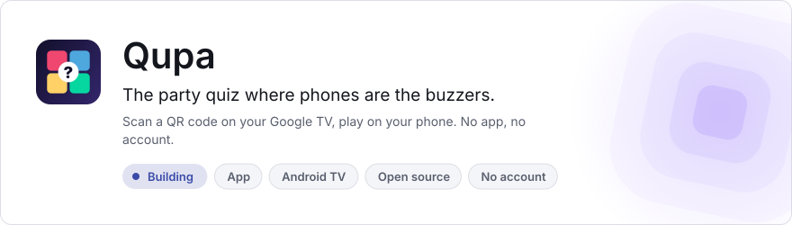
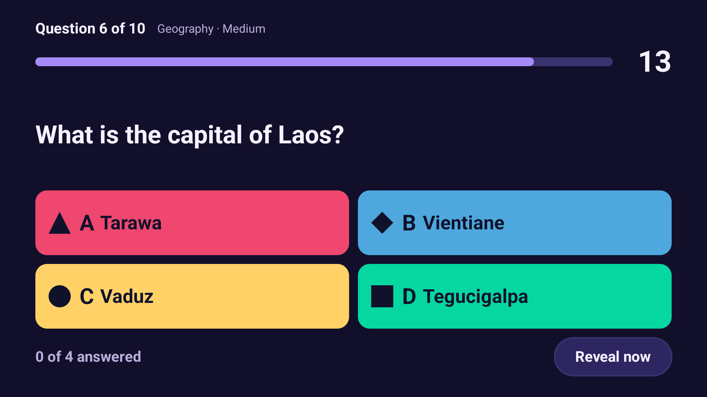
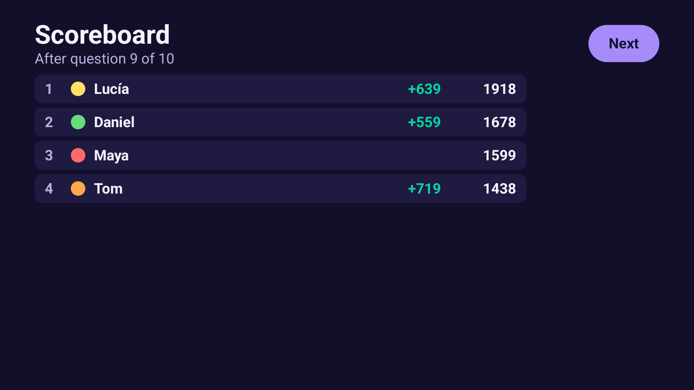
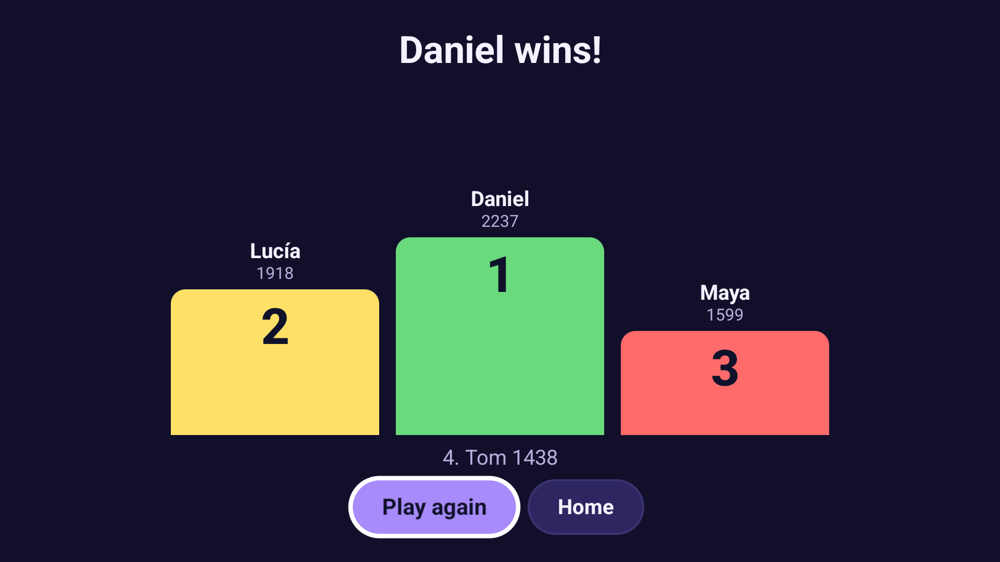
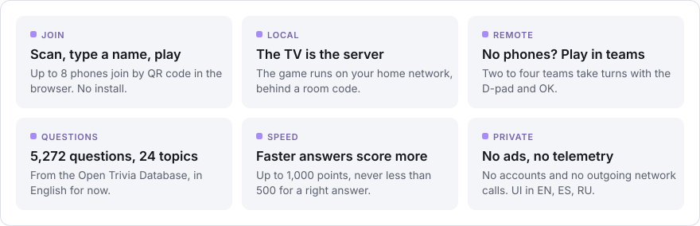
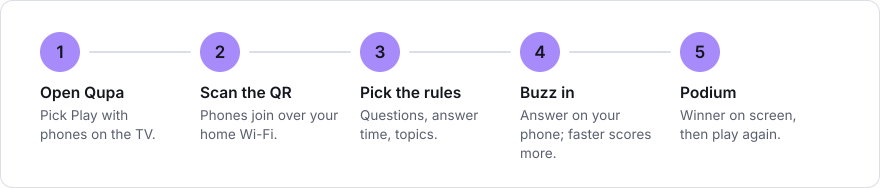

<!-- Pictures: docs/readme/spec.json, drawn by readme-kit. Do not edit the SVGs by hand. -->
<picture><source media="(prefers-color-scheme: dark)" srcset="docs/readme/hero-dark.svg"></picture>

**Open Qupa on the TV, scan the QR code, type a nickname and buzz in.**
Nobody installs an app and nobody makes an account. The TV serves the game on your home network, so nothing goes through the internet. It is a free, MIT-licensed party quiz for Google TV and Android TV.

[Docs](docs/index.md) · [Roadmap](docs/ROADMAP.md) · [Privacy](docs/privacy.md) · [Play Store answers](docs/PLAY-STORE.md)

<p align="center"></p>
<p align="center"> </p>

## What it does

<picture><source media="(prefers-color-scheme: dark)" srcset="docs/readme/highlights-dark.svg"></picture>

- **Game setup.** 10, 15 or 20 questions, answer time 10 to 30 s, your choice of categories and difficulty.
- **Every question ends** with the answer and a scoreboard; the last one ends with a podium.
- **Play again.** "Play again" keeps the players.
- **Phone page.** One self-contained HTML file, no CDN, in English, Spanish or Russian by the phone's language.
- **Reconnect.** Players connect by WebSocket and can rejoin after a dropped connection.
- **Fresh questions.** The app prefers questions you have not seen; it keeps only their ids, on the TV.

## How it works

<picture><source media="(prefers-color-scheme: dark)" srcset="docs/readme/steps-dark.svg"></picture>

| Mode | How it plays |
|---|---|
| **Phones** | "Play with phones" starts a Ktor (CIO) web server on the TV, port 8080 or the next free one, and shows a QR code for `http://<tv-ip>:<port>/?r=<room>`. Every request needs the four-digit room code. Up to 8 players. The server runs only while a lobby or a game is open. |
| **Remote** | Two to four named teams take turns, one question each. The team in turn picks an answer with the D-pad and OK. A correct answer scores a flat 1,000. |

**Scoring with phones.** A correct answer scores 1,000 times the share of time left, and never less than 500.

**Questions.** 5,272 questions in 24 categories from the Open Trivia Database, filtered by `tools/fetch-opentdb.py` and shipped in `app/src/main/assets/questions/en.json`. They are in English for now; `questions/<lang>.json` for a locale is used when present (Spanish and Russian packs are on the [roadmap](docs/ROADMAP.md)).

## Quick start

```sh
git clone https://github.com/zaitsew/qupa && cd qupa
echo "sdk.dir=$HOME/Library/Android/sdk" > local.properties   # your Android SDK path
./gradlew :app:assembleDebug                                   # needs JDK 17 or newer
adb connect <tv-ip>:5555                                       # TV: Settings > Developer options > Network debugging
adb install -r app/build/outputs/apk/debug/app-debug.apk       # then open Qupa from the TV launcher
```

First-run check: `./check.sh usage` prints `telemetry=none`.

## Privacy

No analytics, no ads, no crash-reporting SDK, no accounts and no outgoing network calls.

| Item | Detail |
|---|---|
| Permissions | `INTERNET` (to open the local server port) and `ACCESS_NETWORK_STATE` (to find the TV's address) |
| Nicknames | Stay in the TV's memory during a game |
| Transport | The game page is plain HTTP on your private network |

Full text: [docs/privacy.md](docs/privacy.md).

## Develop

```sh
./check.sh                              # unit tests + lint + debug build (the gate)
git config core.hooksPath .githooks     # run ./check.sh before every push
./check.sh usage                        # prints telemetry=none
./gradlew :core:devServer               # the game server on your laptop, with bot players
```

- **`core/`** is pure Kotlin with no Android: the game engine (an injected clock, a synchronous state machine), the wire protocol, the question bank, the server and the sound synthesizer. Its tests run on the JVM, including a real WebSocket round trip.
- **`app/`** is the Android TV app: Compose for TV screens, DataStore, the QR code, sound.

<details>
<summary>Dev server, strings, tools and release build</summary>

- `./gradlew :core:devServer` serves the phone page at `http://localhost:8080/?r=1234` with a few bot players, so the page can be tried in a desktop browser.
- Strings are in `app/src/main/res/values` (English), `values-es` and `values-ru`.
- `tools/fetch-opentdb.py` rebuilds the question bank (it respects the API's rate limit and takes several minutes).
- `tools/make-banner.swift` redraws the store graphics (macOS).

**Release build.** `./gradlew :app:bundleRelease` builds a shrunk (R8) Android App Bundle in `app/build/outputs/bundle/release/`. It is signed when `~/.qupa/android-signing.properties` exists (`storeFile`, `storePassword`, `keyAlias`, `keyPassword`), and unsigned otherwise. Keys are never committed. The Play Console answers are in [docs/PLAY-STORE.md](docs/PLAY-STORE.md).

</details>

## Docs

| Document | What is in it |
|---|---|
| [docs/index.md](docs/index.md) | The project page |
| [docs/ROADMAP.md](docs/ROADMAP.md) | What comes next, including Spanish and Russian question packs |
| [docs/privacy.md](docs/privacy.md) | The privacy policy |
| [docs/PLAY-STORE.md](docs/PLAY-STORE.md) | Play Console answers and listing notes |

## License

MIT, see [LICENSE](LICENSE). Copyright Fabrique Futur. Questions come from the Open Trivia Database (opentdb.com) under CC BY-SA 4.0.

<sub>Qupa is a door game for your living room: the TV is the BBS and the 8 player slots are its 8 nodes. No ANSI art, sorry.</sub>

<sub>Built by <a href="https://github.com/zaitsew">zaitsew</a> with a fleet of AI agents.</sub>
